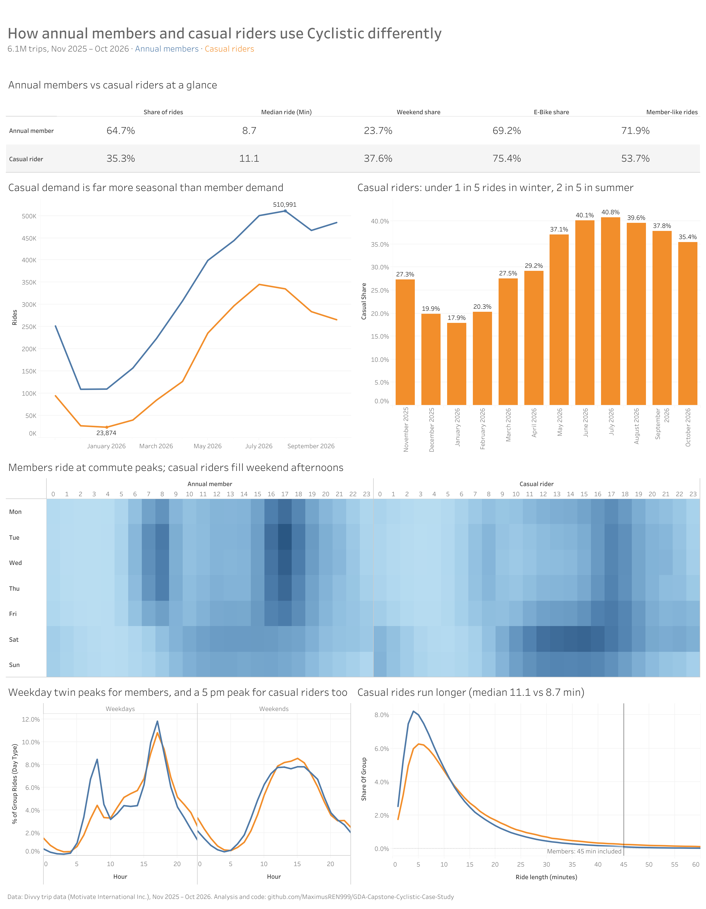
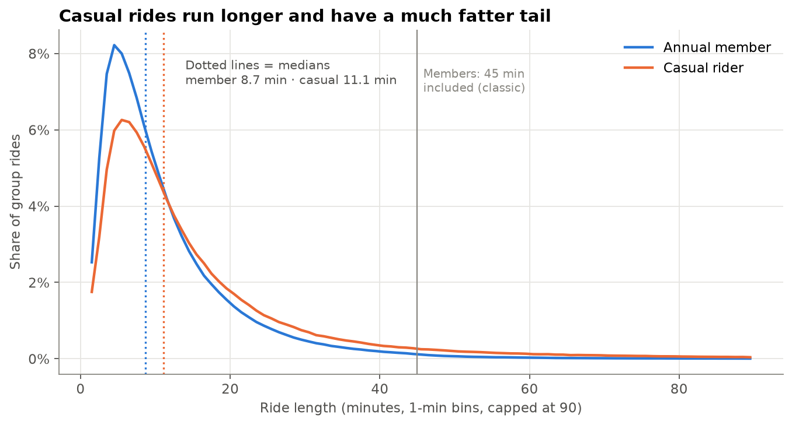
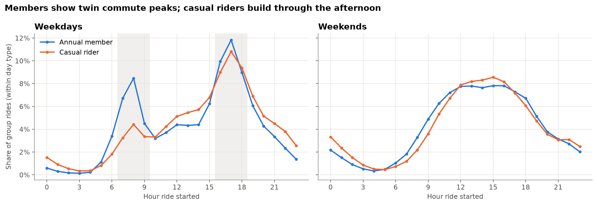
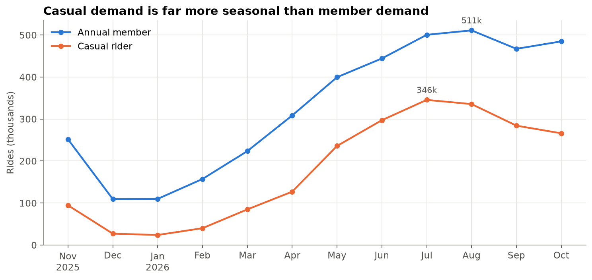
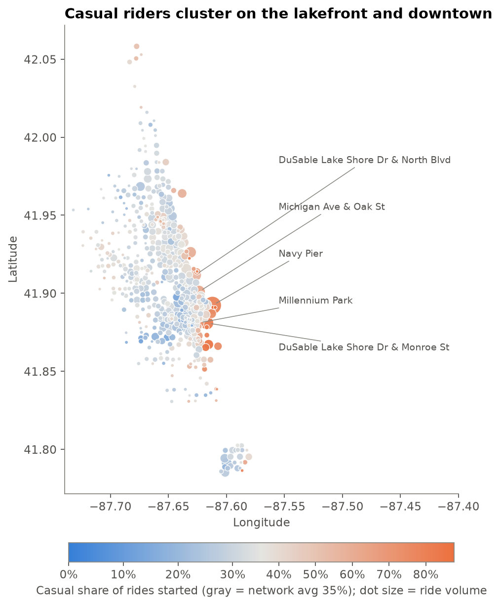
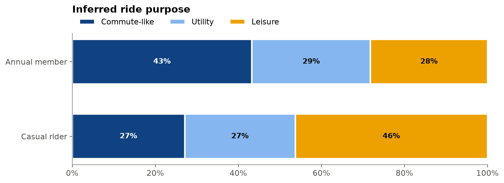
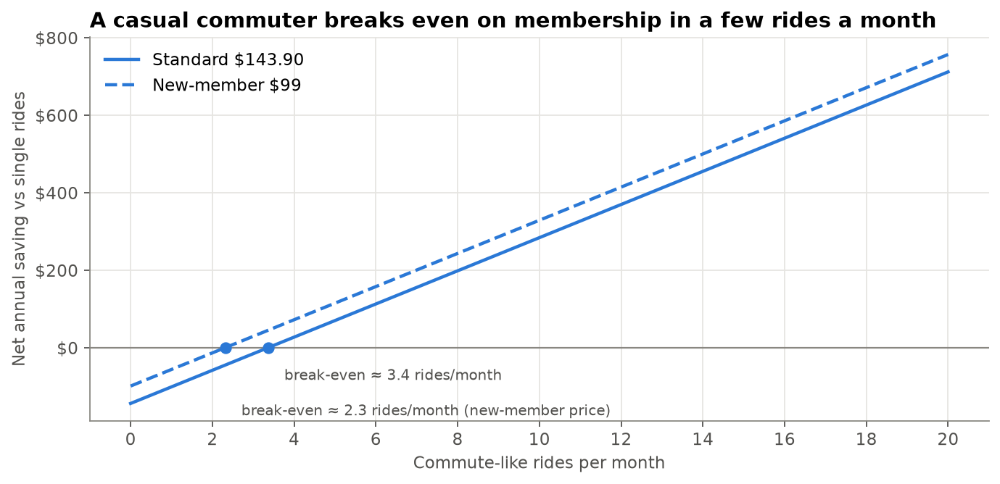

# Cyclistic Bike-Share: Converting Casual Riders into Annual Members

**Google Data Analytics Professional Certificate · Capstone Case Study 1**

Python (pandas, matplotlib) · Tableau Public · 6.1 million trips · November 2025 to October 2026

- **Interactive dashboard:** [Tableau Public](https://public.tableau.com/app/profile/guanlong.max.ren/viz/CyclisticBike-ShareCaseStudy_17953156236340/Howtheyride)
- **Full analysis:** [`cyclistic_case_study.ipynb`](cyclistic_case_study.ipynb)

## 

## Summary

Casual riders are not one group. **54% of casual trips (about 1.16 million) already look like member trips**: weekday, point-to-point and 30 minutes or less. At 2026 Divvy prices, a casual rider making these trips **breaks even on an annual membership at about 3.4 rides a month** (about 2.3 at the $99 new-member price). Cyclistic should target this member-like segment with personalised savings messages, in spring, at commuter-corridor stations, and lead with e-bike pricing.

## Contents

1. [Ask](#1-ask) · 2. [Prepare](#2-prepare) · 3. [Process](#3-process) · 4. [Analyze](#4-analyze) · 5. [Share](#5-share) · 6. [Act](#6-act) · [Repository structure](#repository-structure) · [Reproduce](#how-to-reproduce)

---

## 1. Ask

**Business task:** Identify how annual members and casual riders use Cyclistic bikes differently, find which casual riders are most likely to convert, and recommend when, where and how marketing should reach them.

**Stakeholders:** Lily Moreno (Director of Marketing), the Cyclistic marketing analytics team, and the Cyclistic executive team, who approve the programme.

**Guiding questions**

1. How do annual members and casual riders use Cyclistic bikes differently? _(primary focus)_
2. Why would casual riders buy annual memberships?
3. How can Cyclistic use digital media to influence casual riders to become members?

## 2. Prepare

| Item   | Detail                                                                                                                                            |
| ------ | ------------------------------------------------------------------------------------------------------------------------------------------------- |
| Source | Divvy trip data, published by Motivate International Inc. under the [Divvy Data License Agreement](https://divvybikes.com/data-license-agreement) |
| Period | 12 monthly files, November 2025 – October 2026                                                                                                    |
| Size   | 6,294,451 raw trips, 13 columns                                                                                                                   |
| Grain  | One row = one trip. There is **no rider ID**, so all results are trip-level, not person-level                                                     |

**ROCCC:** Reliable, Original, Current and Cited. It is not fully _Comprehensive_, because it has no rider ID, pass type, price paid, demographics or weather.

**Data issues found during profiling**

- The file named `202501-divvy-tripdata.csv` actually contains **January 2026** trips. Months are derived from `started_at`, not from file names.
- In the October 2026 file, `ride_id` changed from 16-character hex to numeric IDs. It is read as a string to avoid precision loss.
- About 21% of trips have no station name. **These are almost all e-bikes parked outside a dock** (0% of classic-bike trips have no station name). They are _kept_, not dropped.

## 3. Process

**Tool:** Python / pandas, because 6.3M rows is beyond Excel's 1,048,576-row limit and code makes every step auditable. Text columns are stored as `category`, which keeps memory to about 0.5 GB.

| Step | Rule                                                          |          Rows removed |
| ---- | ------------------------------------------------------------- | --------------------: |
| 1    | Duplicate `ride_id` (same trip in two adjacent monthly files) |                    35 |
| 2    | Keep trips that started 2025-11-01 to 2026-10-31              |                   128 |
| 3    | Missing end coordinates                                       |                 5,279 |
| 4    | Trips to or from test, warehouse or depot stations            |                   450 |
| 5    | Ride length < 1 minute (false starts, re-docks, clock errors) |               159,667 |
| 6    | Ride length > 24 hours                                        |                   168 |
|      | **Clean dataset**                                             | **6,128,724 (97.4%)** |

The member/casual mix is the same before and after cleaning (64.7% / 35.3%), so cleaning did not bias either group.

**Engineered features:** `ride_length_min`, `month`, `season`, `day_of_week`, `hour`, `time_of_day`, `is_round_trip`, `distance_km` (haversine), `speed_kmh`, and a rule-based `ride_purpose` (Commute-like / Utility / Leisure).

## 4. Analyze

| Metric                                      | Annual member | Casual rider | Casual vs member |
| ------------------------------------------- | ------------: | -----------: | ---------------: |
| Share of rides                              |         64.7% |        35.3% |            0.54× |
| Median ride length                          |       8.7 min |     11.1 min |            1.28× |
| Rides over 30 min                           |          5.4% |        13.2% |            2.45× |
| Weekend share                               |         23.7% |        37.6% |            1.59× |
| Round-trip share (docked trips)             |          2.2% |         7.4% |            3.34× |
| Median speed, A→B trips                     |     12.1 km/h |    10.5 km/h |            0.86× |
| E-bike share                                |         69.2% |        75.4% |            1.09× |
| Summer (Jun–Aug) share of the group's rides |         36.7% |        45.3% |            1.23× |
| Commute-like + utility share                |         71.8% |        53.7% |            0.75× |

### Key findings

**1. Casual riders ride longer and slower, but not farther.** Point-to-point trips are about the same distance (median 1.8 km vs 1.6 km), but casual riders take 36% longer. They are browsing the city, not racing across it.



**2. Members commute; casual riders ride on weekends and in the afternoon.** Members show a sharp 8 am / 5 pm weekday double peak. Casual riders barely have a morning peak, but their **5 pm weekday peak is almost as high as members'**, so many casual riders already ride home from work.



**3. Casual demand is extremely seasonal.** Casual rides in July are 14.5× January's (members: 4.6×), and they nearly double from April to May. The casual share of all rides goes from 18% in January to 41% in July.



**4. Location splits casual riders into two very different audiences.** Casual-dominated stations sit on the lakefront (Navy Pier, Shedd Aquarium, Millennium Park) and are largely leisure and tourist trips. Casual riders at commuter-corridor stations (Wells St, Canal/Clinton & Madison) are a minority of riders there, and are almost certainly locals.



**5. More than half of casual rides already look like member rides.** By applying the same rules to both groups, **53.7% of casual rides** are commute-like or utility trips (weekday, ≤30 min, point-to-point).



**6. The membership pays for itself quickly.** Using 2026 Divvy prices (casual: $1 unlock + $0.19/min classic, $0.44/min e-bike; member: $143.90/yr, 45 min classic included, $0.20/min e-bike), a commute-like casual ride would cost about **$3.57 less** as a member. **Break-even ≈ 3.4 rides a month** ($143.90) or **2.3** ($99 new-member offer).



## 5. Share

- Interactive dashboard: [Tableau Public](https://public.tableau.com/app/profile/guanlong.max.ren/viz/CyclisticBike-ShareCaseStudy_17953156236340/Howtheyride)). Two pages: _How they ride_ and _Where to convert_.
- Static charts: [`figures/`](figures)
- Tableau-ready aggregated data: [`tableau/`](tableau). These tables are aggregated in Python, so the dashboard uses exactly the same definitions as the notebook.

## 6. Act

### Recommendation 1: Target "member-like" casual riders with a personalised savings message

After a casual rider's 3rd weekday ride in 30 days, an in-app message says: _"This month you paid $X. As a member you'd have paid $Y."_ It links to the $99 new-member offer. Geo-fenced ads and station QR codes go at commuter-corridor stations during the 7–9 am and 4–7 pm weekday windows.
**KPI:** 30-day conversion rate of the triggered group compared with a hold-out group, CAC, and first-year renewal rate.

### Recommendation 2: Time the budget to the season

Weight spend toward **March–May**, when casual riding ramps up and a membership covers the whole season. Use June–August for reach, and September–October for "your year on Cyclistic" recap messages. Do not run conversion ads in winter. Consider a **winter pause** option to remove the "I won't ride in winter" objection.
**KPI:** New members by month and seasonal campaign ROI.

### Recommendation 3: Lead with e-bike pricing, and give weekend riders an upgrade path

75% of casual rides are on e-bikes, which members ride for less than half the casual per-minute price. Use one message everywhere: _"Members ride e-bikes for less than half price."_ At lakefront stations, offer to **credit today's day pass toward a membership within 7 days**. This gives local weekend riders a low-risk trial without pushing annual passes on tourists.
**KPI:** Day-pass-to-member upgrade rate and conversion on e-bike creative.

### Limitations and next data to collect

- Trip-level data only: a hashed rider ID would let us count _riders_ who ride at least 3 times a month.
- Pass type and price paid are needed to calibrate the price model, which currently assumes casual trips are single rides.
- Home postcode would separate tourists from local casual riders.
- `ride_purpose` is inferred from rules, not observed. Weather and events were not modelled.

---

## Repository structure

```
├── cyclistic_case_study.ipynb   # full analysis: Ask → Act
├── figures/                     # exported charts (PNG)
├── tableau/                     # aggregated CSVs that feed the Tableau dashboard
├── data/
│   ├── raw/                     # 12 monthly CSVs (not committed, see below)
│   └── processed/               # summary tables (the large parquet file is not committed)
├── requirements.txt
└── README.md
```

## How to reproduce

1. Download the 12 monthly files (2025-11 → 2026-10) from the [Divvy trip data page](https://divvy-tripdata.s3.amazonaws.com/index.html) and unzip them into `data/raw/`.
2. Create an environment and install the dependencies:
   ```bash
   python -m venv .venv
   source .venv/bin/activate        # Windows: .venv\Scripts\activate
   pip install -r requirements.txt
   ```
3. Open `cyclistic_case_study.ipynb` in VS Code or Jupyter and run all cells (about 2 minutes, with at least 8 GB RAM recommended).

## Author

**Max Ren** · [LinkedIn](https://www.linkedin.com/in/max-ren-data/) · [Tableau Public](https://public.tableau.com/app/profile/guanlong.max.ren/)
